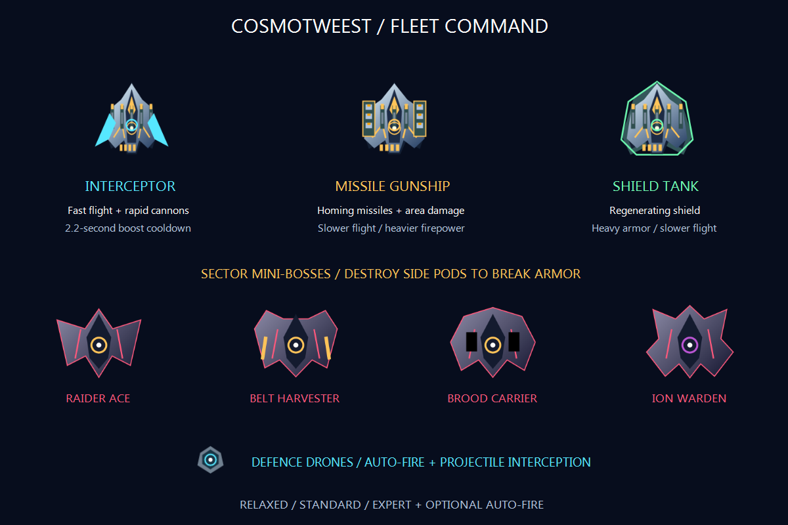

# CosmoTweest 🚀

An offline single-player space shooter for Windows. Pilot a rocket through five increasingly dangerous sectors, choose your ship upgrades, fight mini-bosses, and build a small fleet of defence drones.

[](LICENSE)
[](https://github.com/twistkan/cosmotweest/releases/latest)

## Download and play

**[Download the portable game](https://github.com/twistkan/cosmotweest/releases/latest/download/CosmoTweest-Portable.zip)** · **[Download the Windows setup](https://github.com/twistkan/cosmotweest/releases/latest/download/CosmoTweestSetup.exe)**

The portable ZIP is the simplest option:

1. Extract the whole **CosmoTweest FINAL** folder into Desktop, Documents, or another writable location.
2. Open **CosmoTweest.exe**. No installation or development tools are needed.
3. The game creates a desktop shortcut with its rocket icon. If you move the folder, open the EXE once from its new location to refresh the shortcut.

The **Data** folder keeps your scores, unlocked sectors, and settings. Close the game before copying the whole folder to another PC to take your progress along. Public downloads start fresh; no developer/player saves are included.

If you prefer installation, run **CosmoTweestSetup.exe** for a per-user install, shortcuts, and an uninstaller. The installer imports an accompanying portable save only when that Windows account has no existing CosmoTweest profile. Existing installed progress is preserved.

**Requirements:** 64-bit Windows 10 or 11 with the normal Windows .NET Framework 4.x component. No Python, SDK, engine tools, internet connection, or additional game-asset downloads are required to play. The executables are unsigned.

> GitHub's **Code → Download ZIP** contains the source project. Use the download links above for the ready-to-play game.

## Fleet Command



- **Five sectors:** escalating enemy formations, asteroids, supply containers, and a final two-phase dreadnought.
- **Branching upgrades:** earn optional gold cores at 1,500, 5,000, and 11,000 points. The action pauses while you choose Interceptor, Missile Gunship, or Shield Tank. Improve the same path or switch at a later core.
- **Four mini-bosses:** Raider Ace, Belt Harvester, Brood Carrier, and Ion Warden. Destroy their side pods to break their armor.
- **Defence drones:** collect up to two companions that fire with you and periodically intercept enemy shots.
- **Difficulty options:** Relaxed, Standard, and Expert, with separate high scores and optional auto-fire.
- **Offline saves and sound controls:** portable progress, master/music/effects sliders, and instant mute/unmute.

| Ship path | Strength | Tradeoff |
| --- | --- | --- |
| Interceptor | Faster flight, rapid cannons, shorter boost cooldown | No missiles or regenerating shield |
| Missile Gunship | Guided missiles with splash damage | Slower movement and primary cannon cadence |
| Shield Tank | Regenerating protective shield | Slower movement |

Earned ship rank, branch, and drones survive sector transitions and retries. A new campaign starts with the Scout. Resources remain limited; emergency ammunition and a free crate-opening rescue pulse prevent an empty magazine from trapping a run.

## Controls

| Input | Action |
| --- | --- |
| Mouse movement | Steer the rocket; shots fire upward in default mouse-flight mode |
| Left mouse, held | Continuous fire |
| Right mouse | Area-damage bomb |
| Middle mouse / Space | Evasive boost |
| WASD / arrow keys | Alternative movement |
| Esc | Pause / resume |
| M | Sound on / off |
| F11 | Fullscreen / windowed |
| Mouse or Left/Right + Enter or 1–3 | Choose a ship upgrade |

Open **Settings → Flight & Difficulty** for Relaxed mode, auto-fire, or the original keyboard-movement/mouse-aiming controls. New players may find Relaxed + Auto-fire comfortable to start with. Difficulty changes apply to the next run; restarting the active sector retains its original difficulty.

## Build from source

Clone this repo into a writable folder, open PowerShell there, and run:

```powershell
.\Source\build.ps1
```

The script uses the Windows .NET Framework C# compiler, `%WINDIR%\Microsoft.NET\Framework64\v4.0.30319\csc.exe`, and framework assemblies only. It builds **CosmoTweest.exe** and **CosmoTweestSetup.exe** in this same folder. No NuGet dependencies. Close either EXE before replacing it. Existing **Data/settings.txt** is preserved.

All runtime artwork and music/effects are generated from original project code. The installer embeds the game executable and credits/license.

- `Source/src`: simulation, native window, art, audio, controls, and game systems.
- `Source/tools`: installer and icon-generation source.
- `Source/tests/Verify.ps1`: builds and runs isolated checks under `Source/tests/build`.
- `Source/tools/Package-PublicRelease.ps1`: creates clean public release assets, excluding player profiles and local test artifacts.

Run verification with:

```powershell
.\Source\tests\Verify.ps1
```

## Verification and limits

The development build passed **97 simulation/settings assertions**, **48 application assertions**, and all **nine ship-path/difficulty campaign combinations**. Each combination reached victory, defeated all four mini-bosses, reached rank III, and equipped two drones. The QA pilots automatically repair low hull: these tests establish progression and stability rather than unaided human difficulty balance.

A rendered campaign reached victory. The portable profile was also checked after copying/moving the game, and the installer payload, shortcut, uninstall, and profile-import behavior were checked locally. Clean-PC installation and human balance/audio evaluation remain unverified. Application input tests invoke the game's event handlers rather than physical input devices.

An older Windows 10 / Intel i5-2400 / GTX 1660 test PC measured about **50 FPS** at 1100×800 over a 32-second native-window benchmark. Performance varies with hardware and effects load. The renderer uses Windows GDI+/GDI. See [verification details](docs/VERIFICATION.md).

## Sharing, feedback, and credits

Sharing, modifying, and redistributing CosmoTweest is welcome under the **[MIT license](LICENSE)**. Keep the copyright/license notice with redistributed copies. Source code, sprites, icon, backgrounds, sound effects, and music were created for this project. Windows-provided fonts and framework binaries are not redistributed; see [credits](Credits/CREDITS.md).

Found a bug or have an idea? [Open an issue](https://github.com/twistkan/cosmotweest/issues), including the game version, Windows version, and steps to reproduce. Please keep private saved data and credentials out of issue attachments.
